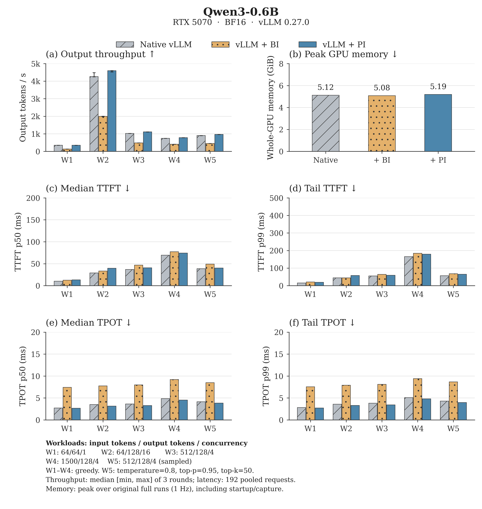
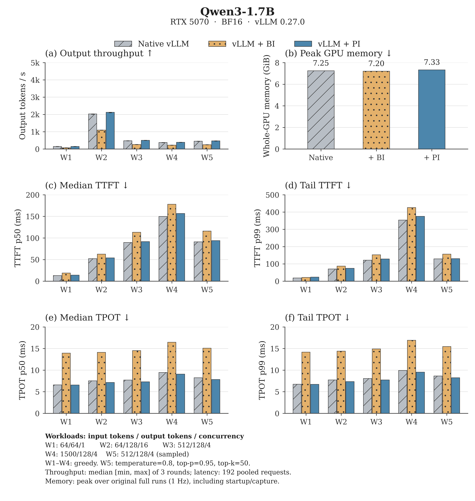

# RTX 5070：vLLM 0.27.0 服务集成与对比

三种模式均运行真实 vLLM 服务；PI 模式替换 Attention 和全部 BF16 dense/LM-head GEMM。

- 固定单张 RTX 5070、BF16、TP=1；不承诺跨 GPU/架构一致。
- 本地模型：Qwen3-0.6B, Qwen3-1.7B；独立 uv workspace，版本锁见 `benchmarks/vllm027/uv.lock`。
- 所有模式 ctx=2048、max-seqs=16、prefill-budget=512、page=16、KV=1.75 GiB；开启 prefix cache、chunked prefill、async scheduling 和 CUDA Graph。
- WSL 不支持 vLLM MRv2 依赖的 UVA，三种模式统一设置 `VLLM_USE_V2_MODEL_RUNNER=0`。vLLM 仍为 0.27.0。
- 每负载 64 requests × 3 轮，模式轮换顺序，GPU 串行测试；吞吐取三轮中位数，延迟分位数合并 192 个 request。
- PI 启动时预热生成路径所有 GEMM 行数区间。每个负载计时前后均核对调优记录，表中只计入调优状态一致的完整三轮。

## 严格确定性

PI 通过 1552 次 request 比较，共 86136 对 token ID / logprob，均为零差异。这是已测范围内的逐位一致性结果。

比较每种模式自身的基准结果：token IDs 与生成 token 的 FP32 raw-logprob 位模式；不同实现之间不要求逐位相同。

| 模型 | 模式 | HTTP request 比较 | token 位差 | logprob 位差 |
|---|---|---:|---:|---:|
| Qwen3-0.6B | native | 576 | 5092 | 31061 |
| Qwen3-0.6B | batch-invariant | 576 | 2514 | 13216 |
| Qwen3-0.6B | pi | 576 | 0 | 0 |
| Qwen3-1.7B | native | 576 | 3750 | 21785 |
| Qwen3-1.7B | batch-invariant | 576 | 436 | 4483 |
| Qwen3-1.7B | pi | 576 | 0 | 0 |

固定基础配置的结果单独列出，避免把跨配置差异与 batch 差异混为一谈。单元格为 token / logprob 不一致位置数：

| 模型 | 模式 | base greedy | base sampled |
|---|---|---:|---:|
| Qwen3-0.6B | native | 1200 / 10189 | 2321 / 8875 |
| Qwen3-0.6B | batch-invariant | 0 / 0 | 1051 / 1073 |
| Qwen3-0.6B | pi | 0 / 0 | 0 / 0 |
| Qwen3-1.7B | native | 849 / 7054 | 1226 / 6030 |
| Qwen3-1.7B | batch-invariant | 0 / 0 | 0 / 0 |
| Qwen3-1.7B | pi | 0 / 0 | 0 / 0 |

官方 BI 的默认 sampler 在 batch ≥ 8 时切换 top-k/top-p 实现；独立 [采样分派诊断](sampling-dispatch-diagnostic.json) 检出位差，固定分派后通过。上述 base 表保留模型与采样方式的区别，跨配置失败也不等同于固定配置的 batch-invariance 失败。

HTTP 检查覆盖并发 1/2/3/4/7/8/9/16、排列、干扰请求、冷/热/部分 prefix cache、20 次重复、共享前缀、greedy re-prefill、sampled teacher forcing，以及 eager/Graph、chunk=256/512/关闭、max-seqs=1、page=16/32、热重启和新的编译缓存目录。
每次 sampled request 固定 seed、temperature=0.8、top_p=0.95、top_k=50。将生成前缀作为新 request 并重用 seed 会重置 vLLM RNG，所以不把这种 sampled continuation 当作相同 RNG 状态。

- Qwen3-0.6B 另通过 200 组受控离线 batch 比较（6400 token）；[GPU trace kernel 摘要](Qwen3-0.6B/pi/offline/trace-kernels.json) 和每次服务的 `pi-runtime.json` 验证了 PI prefill/decode、5 种投影权重形状与 LM head 的真实执行，无 GEMM fallback。
- Qwen3-1.7B 另通过 200 组受控离线 batch 比较（6400 token）；[GPU trace kernel 摘要](Qwen3-1.7B/pi/offline/trace-kernels.json) 和每次服务的 `pi-runtime.json` 验证了 PI prefill/decode、5 种投影权重形状与 LM head 的真实执行，无 GEMM fallback。

PI 使用官方 BI 辅助路径，同时固定 top-k/top-p 算法，给非 residual RMSNorm 增加 opaque custom-op 边界，并禁用 QK-norm/RoPE 融合。当前 Inductor 包装将 RMSNorm 的 eps 标为 FP64，提升后续计算精度而改变位模式；边界保留原始 Triton 路径。证据见 [编译诊断](diagnostics/rms-compilation.json)，独立回归见 [norm-checks.json](norm-checks.json)。这些开销都包含在 PI 服务性能内。

## 服务吞吐

单位 output tokens/s。仅展示 W1–W5，负载为 input/output/concurrency；W1–W4 使用 greedy，W5 为原 W6 的采样负载（S）。各模式使用相同的合成 token-ID 输入。全部六种负载的三轮吞吐见 [summary.json](summary.json)。

| 模型 | 负载 | native | 官方 BI | PI | PI/BI | PI/native |
|---|---|---:|---:|---:|---:|---:|
| Qwen3-0.6B | W1: 64/64/1 | 351.7 | 132.9 | 350.8 | 2.64× | 1.00× |
| Qwen3-0.6B | W2: 64/128/16 | 4262.1 | 1999.8 | 4596.7 | 2.30× | 1.08× |
| Qwen3-0.6B | W3: 512/128/4 | 1026.1 | 482.4 | 1111.8 | 2.30× | 1.08× |
| Qwen3-0.6B | W4: 1500/128/4 | 744.2 | 409.5 | 784.4 | 1.92× | 1.05× |
| Qwen3-0.6B | W5: 512/128/4 S | 903.3 | 453.3 | 967.1 | 2.13× | 1.07× |
| Qwen3-1.7B | W1: 64/64/1 | 149.1 | 71.2 | 149.1 | 2.09× | 1.00× |
| Qwen3-1.7B | W2: 64/128/16 | 2027.3 | 1096.5 | 2122.4 | 1.94× | 1.05× |
| Qwen3-1.7B | W3: 512/128/4 | 480.3 | 261.1 | 502.2 | 1.92× | 1.05× |
| Qwen3-1.7B | W4: 1500/128/4 | 377.5 | 225.3 | 389.5 | 1.73× | 1.03× |
| Qwen3-1.7B | W5: 512/128/4 S | 450.3 | 252.0 | 470.1 | 1.87× | 1.04× |

- Qwen3-0.6B：PI 吞吐为官方 BI 的 1.92–2.64 倍、原生的 0.997–1.083 倍。
- Qwen3-1.7B：PI 吞吐为官方 BI 的 1.73–2.09 倍、原生的 1.000–1.047 倍。

吞吐改善不代表所有延迟指标都改善；PI 在部分负载的 TTFT 高于原生，需结合下表选择。

## 延迟与显存

TTFT/TPOT 单位 ms，单元格为 p50 / p95 / p99。TPOT 是首末流式事件间隔除以输出 token 数减一；多 token chunk 原样保留，不据此伪造逐 token 时间。

| 模型 | 负载 | 模式 | TTFT | TPOT |
|---|---|---|---:|---:|
| Qwen3-0.6B | W1: 64/64/1 | native | 10.15 / 12.70 / 15.27 | 2.72 / 2.78 / 2.82 |
| Qwen3-0.6B | W1: 64/64/1 | batch-invariant | 12.57 / 15.00 / 21.08 | 7.42 / 7.53 / 7.56 |
| Qwen3-0.6B | W1: 64/64/1 | pi | 13.31 / 15.85 / 19.11 | 2.67 / 2.72 / 2.73 |
| Qwen3-0.6B | W2: 64/128/16 | native | 29.09 / 37.81 / 44.65 | 3.51 / 3.57 / 3.59 |
| Qwen3-0.6B | W2: 64/128/16 | batch-invariant | 33.44 / 41.19 / 44.83 | 7.77 / 7.86 / 7.90 |
| Qwen3-0.6B | W2: 64/128/16 | pi | 39.82 / 50.90 / 57.83 | 3.16 / 3.27 / 3.32 |
| Qwen3-0.6B | W3: 512/128/4 | native | 36.93 / 47.98 / 55.45 | 3.64 / 3.75 / 3.82 |
| Qwen3-0.6B | W3: 512/128/4 | batch-invariant | 46.90 / 49.40 / 64.60 | 7.99 / 8.08 / 8.11 |
| Qwen3-0.6B | W3: 512/128/4 | pi | 40.83 / 53.60 / 58.99 | 3.29 / 3.40 / 3.44 |
| Qwen3-0.6B | W4: 1500/128/4 | native | 69.44 / 82.65 / 165.63 | 4.86 / 5.07 / 5.10 |
| Qwen3-0.6B | W4: 1500/128/4 | batch-invariant | 77.31 / 82.29 / 184.37 | 9.20 / 9.36 / 9.40 |
| Qwen3-0.6B | W4: 1500/128/4 | pi | 74.43 / 94.26 / 179.33 | 4.53 / 4.74 / 4.80 |
| Qwen3-0.6B | W5: 512/128/4 S | native | 38.67 / 46.29 / 56.74 | 4.16 / 4.25 / 4.29 |
| Qwen3-0.6B | W5: 512/128/4 S | batch-invariant | 49.04 / 51.84 / 68.07 | 8.51 / 8.61 / 8.67 |
| Qwen3-0.6B | W5: 512/128/4 S | pi | 40.10 / 59.08 / 64.86 | 3.85 / 3.94 / 3.97 |
| Qwen3-1.7B | W1: 64/64/1 | native | 12.94 / 14.65 / 18.22 | 6.59 / 6.70 / 6.74 |
| Qwen3-1.7B | W1: 64/64/1 | batch-invariant | 18.77 / 20.02 / 21.41 | 13.94 / 14.09 / 14.16 |
| Qwen3-1.7B | W1: 64/64/1 | pi | 13.95 / 17.06 / 23.45 | 6.57 / 6.67 / 6.71 |
| Qwen3-1.7B | W2: 64/128/16 | native | 52.11 / 67.33 / 70.34 | 7.53 / 7.69 / 7.73 |
| Qwen3-1.7B | W2: 64/128/16 | batch-invariant | 62.55 / 79.81 / 87.42 | 14.13 / 14.32 / 14.41 |
| Qwen3-1.7B | W2: 64/128/16 | pi | 54.03 / 70.43 / 74.63 | 7.16 / 7.29 / 7.36 |
| Qwen3-1.7B | W3: 512/128/4 | native | 89.48 / 92.20 / 121.30 | 7.70 / 8.01 / 8.07 |
| Qwen3-1.7B | W3: 512/128/4 | batch-invariant | 113.26 / 116.09 / 152.44 | 14.54 / 14.85 / 14.90 |
| Qwen3-1.7B | W3: 512/128/4 | pi | 91.70 / 96.46 / 128.63 | 7.31 / 7.64 / 7.73 |
| Qwen3-1.7B | W4: 1500/128/4 | native | 149.97 / 154.78 / 353.88 | 9.47 / 9.85 / 9.91 |
| Qwen3-1.7B | W4: 1500/128/4 | batch-invariant | 178.12 / 193.57 / 425.99 | 16.45 / 16.81 / 16.91 |
| Qwen3-1.7B | W4: 1500/128/4 | pi | 156.62 / 163.88 / 375.58 | 9.09 / 9.51 / 9.54 |
| Qwen3-1.7B | W5: 512/128/4 S | native | 91.18 / 94.30 / 128.96 | 8.24 / 8.55 / 8.64 |
| Qwen3-1.7B | W5: 512/128/4 S | batch-invariant | 115.94 / 119.35 / 156.41 | 15.09 / 15.41 / 15.46 |
| Qwen3-1.7B | W5: 512/128/4 S | pi | 93.96 / 100.01 / 130.30 | 7.83 / 8.15 / 8.24 |

| 模型 | native GPU 峰值 MiB | BI GPU 峰值 MiB | PI GPU 峰值 MiB |
|---|---:|---:|---:|
| Qwen3-0.6B | 5246 | 5206 | 5318 |
| Qwen3-1.7B | 7422 | 7375 | 7504 |

显存为 nvidia-smi 每秒采样的整卡占用峰值，包含服务启动与 Graph 捕获，不等同于模型独占显存。此项沿用原始完整服务运行的测量；历史显存样本没有逐条时间戳，无法精确拆分出本次选定五个负载的峰值。

### PI 显存差异的解释

| 模型 | PI 相对 native | PI 相对官方 BI |
|---|---:|---:|
| Qwen3-0.6B | +72 MiB（+1.37%） | +112 MiB（+2.15%） |
| Qwen3-1.7B | +82 MiB（+1.10%） | +129 MiB（+1.75%） |

已确认三种模式的模型权重、BF16 格式与 1.75 GiB KV cache 预算一致。两个模型的 `bench-0/server.log` 均记录相同的 KV 容量（16,384 tokens）；同模型的加载显存也一致。

PI 的 [attention metadata builder](../../../../benchmarks/vllm027/pi_attn_vllm/backend.py) 为 prefill/decode 预分配 FP32 部分结果和归约状态。在本配置（16 个 query heads、context=2048、prefill-budget=512、max-seqs=16）下，每个 builder 的 prefill 工作区为 16.25 MiB，decode 工作区为 0.546875 MiB，共约 16.80 MiB。该数值是 PI 自身的缓冲区大小，并非相对官方 backend 的净增量。

此外，[GEMM 调优器](../../../../kernels/pi_vllm_torch.cu) 会分配临时输入、输出和 2×L2 容量的缓存冲刷缓冲区，[启动预热](../../../../benchmarks/vllm027/pi_attn_vllm/worker.py) 会覆盖所有行数区间。释放临时 tensor 后，PyTorch 缓存分配器保留的显存仍可能计入 nvidia-smi，参见 [PyTorch 内存管理说明](https://docs.pytorch.org/docs/main/notes/cuda.html#memory-management)。这是额外峰值/保留显存的可能来源，现有记录未做逐项消融，不能精确分摊全部差额。

也不能将差额直接归因于 PI 的 CUDA Graph 更大：两模型 `bench-0` 日志中，PI 和官方 BI 的 graph capture 均约 0.02 GiB，native 约 0.05 GiB。当前结论是这套 PI 集成的整卡测量峰值略高，不能据此推出确定性推理必然需要同等额外显存。

## 复现与原始证据

在仓库根目录运行以下命令。脚本会按轮次自行启动和停止服务。

```bash
bash benchmarks/vllm027/run_serving.sh all
```

仓库提供[服务汇总](summary.json)和 [JIT 日志审计](timing-jit-audit.json)。本地重跑会在各模型、模式和配置目录下生成逐请求检查、启动清单、服务日志和 PI 运行状态。`bench-{0,1,2}/benchmark.json` 记录输入和输出 token、seed、请求起止时间、SSE 事件及 usage。启动清单记录命令、依赖、源码与权重哈希、GPU 信息。GPU trace 单独采集。JIT 日志的时间精度为秒，审计中单独标出与计时边界重叠的事件。

官方 BI 的模型 dense 与 LM head 显式使用 Triton persistent GEMM；SM120 的 ATen torch.mm/cuBLASLt 测量不能替代这一服务路径。算子微基准与服务吞吐的区别见 [算子报告](../README.md)。本报告仅覆盖实测模型、输入范围、配置与该单卡，不是所有输入的形式化确定性证明。

## 论文风格性能图

每个模型一张 3×2 柱状子图，依次为吞吐、整卡峰值占用、TTFT p50/p99、TPOT p50/p99。两个模型的对应子图采用相同坐标范围；全部柱状图从零起始，配色与纹理可用于彩色或灰度打印。

吞吐和延迟仅展示 W1–W5（原 W6 采样负载改为 W5），负载参数为 input/output/concurrency。吞吐柱高为三轮中位数，误差线为三轮最小值至最大值，不是置信区间。延迟使用合并 192 个 request 的分位数；显存沿用原始完整运行的三轮整卡采样峰值，包含启动和 Graph 捕获，不按选定负载重新计算。图中 PI 包含 Attention、GEMM 与固定辅助路径。

### Qwen3-0.6B



[PDF（矢量）](figures/qwen3-0.6b-serving.pdf) · [SVG（矢量）](figures/qwen3-0.6b-serving.svg) · [PNG（600 dpi）](figures/qwen3-0.6b-serving.png)

### Qwen3-1.7B



[PDF（矢量）](figures/qwen3-1.7b-serving.pdf) · [SVG（矢量）](figures/qwen3-1.7b-serving.svg) · [PNG（600 dpi）](figures/qwen3-1.7b-serving.png)

绘图数据直接读取本目录的 `summary.json`，不使用 Markdown 中四舍五入后的数值。
[绘图数值 CSV](figures/plot-data.csv) 与 [绘图清单/哈希](figures/manifest.json) 可用于核对。

```bash
uv run --locked --script benchmarks/vllm027/plot_serving.py
```
